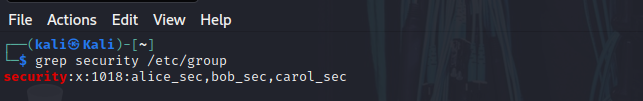

# Lab Title: Network-Device-Sweep-&-Intrusion-Detection

**Scenario**
You are a cybersecurity analyst for SecureNet Corp, a mid-sized enterprise that recently faced a network intrusion. The attacker exploited Bring Your Own Device (BYOD) policies to connect an unauthorized device to the corporate network.Although the attack was contained, you are tasked with creating a network sweep script that can:

● Ping all devices in a given subnet. 

● Extract and log the IP addresses of devices that respond. 

● Restrict execution so that only members of the security group can run the script. 

● Save the results to a file for later comparison against the company's inventory list.

**Objective**
1. **Identity & Access Management (IAM):** Create a dedicated security group and assign members to it.
2. **Bash Scripting:** Develop a network discovery tool (`testsweep.sh`) to ping a specified subnet and log active IP addresses.
3. **File Permissions:** Enforce strict access controls using `chmod` and `chown` to prevent unauthorized users from viewing, modifying, or executing the script.

**Tools Used**
* **Operating System:** Kali Linux Virtual Machine System
* **Commands:** `ping`, `grep`, `cut`, `tr`, `chmod`, `chown`, `adduser`, `groupadd`, `usermod`, `su`
* **Concepts:** Network Discovery, Linux File Permissions, IAM

# Part 1: Security Group Setup
1. **Created the security group**
   
   `sudo groupadd security `

2. **Created users: alice_sec, bob_sec, carol_sec**
   
   `sudo adduser alice_sec`

   `sudo adduser bob_sec`

   `sudo adduser carol_sec`

4. **Added Users to the Security Group**
   
   `sudo usermod -aG security alice_sec`

   `sudo usermod -aG security bob_sec`

   `sudo usermod -aG security carol_sec`

6. **Set Up the Shared Directory**
   
   `sudo mkdir -p /home/shared/security`

# Part 2: Network Sweep Script
1. **Verified the IP address: Under eth0: inet 10.0.2.**
   
   `ip a`

2. **Added the Script File- testsweep.sh**
   
   `mousepad /home/shared/security/testsweep.sh`

3. **Wrote the Script Code**

```bash
#!/bin/bash

# 1. Check if a subnet argument was provided
if [ -z "$1" ]; then
    echo "Error: No subnet provided."
    echo "Usage: ./testsweep.sh <subnet>"
    echo "Example: ./testsweep.sh 10.0.2"
    exit 1
fi

# 2. Assign variables
SUBNET=$1
OUTPUT_FILE="sweep_results.txt"

# 3. Clear output file if it exists, or create a new one
> $OUTPUT_FILE

# 4. Print the starting messages
echo "Starting network sweep on $SUBNET.1 to $SUBNET.254..."
echo "This may take a moment..."

# 5. Ping loop (runs in parallel for speed)
for ip in {1..254}; do
    ping -c 1 -W 1 $SUBNET.$ip | grep "bytes from" | cut -d " " -f 4 | tr -d ":" >> $OUTPUT_FILE &
done

# 6. Wait for all pings to finish
wait

# 7. Print completion message
echo "Sweep complete! Active devices logged in $OUTPUT_FILE."

```

4. **Verified the Script File is in the Group**

   `ls /home/shared/security`

5. **Ownership and Permissions - Group members only**
   
   `sudo chown kali:security /home/shared/security/testsweep.sh`
   
   `sudo chmod 770 /home/shared/security/testsweep.sh`

6. **Created a sweep file in /home/shared/security/: sweep_results.txt**
   
    `sudo touch /home/shared/security/sweep_results.txt`

7. **Ownership and Permissions - sweep_results.txt**
   
   `sudo chown kali:security /home/shared/security/sweep_results.txt`
   
   `sudo chmod 770 /home/shared/security/sweep_results.txt`

## Results of Part 1 & Part 2
   
      

## Deliverables
1. **Verification of Group and Users Created**

    Run the command `grep security /etc/group`

   

2. **Script File with Correct Permissions**
   
   Run the command `ls -l /home/shared/security/testsweep.sh` to confirm only security group members have execute rights.

    

3. **Execution, Testing and Results**
   
   3.1. **Switch to a security member e.g alice_sec:** Use the command `su - alice_sec` and enter the password

   3.2. **Run the Script:** Restrict execution so that alice_sec can run the script. Run the commands `cd /home/shared/security` and `./testsweep.sh 10.0.2`

   3.3. **Show the Content of Script:** For testsweep.sh, run the command `cat testsweep.sh`

   3.4. **Show the Content of Textfile:** Run `cat sweep_results.txt`.You should see either list of IP addresses or a clean, blank return if the network is empty. This depends on whether there were any active devices on the 10.0.2.

      


   

